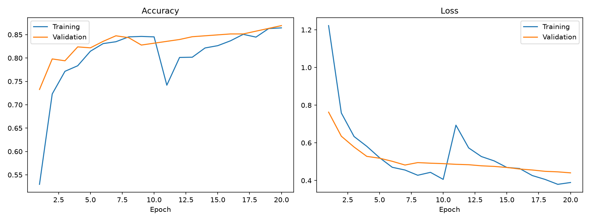
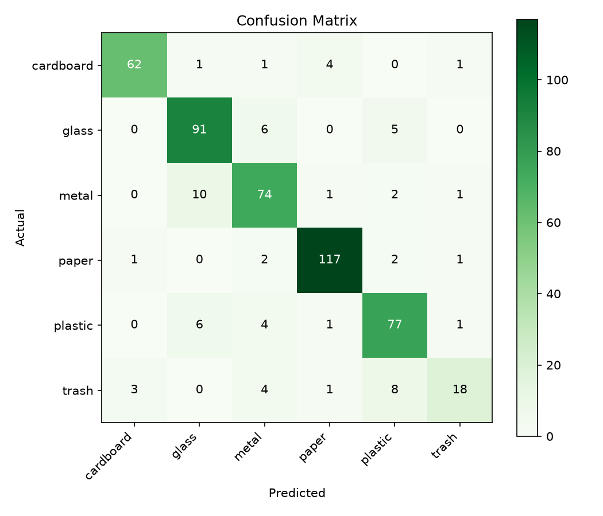

# ♻️ WasteWise: Deep Learning-Based Waste Classification

WasteWise is a Streamlit web app that classifies an uploaded waste image into **cardboard, glass, metal, paper, plastic or trash** using a CNN built with **MobileNetV2 transfer learning** (TensorFlow/Keras). It shows the predicted category, confidence and class-wise probabilities.

> No accuracy figures are claimed here. Train the model yourself and paste your own results in the "Results" section.

## Features
- Image upload, preview, Predict and Clear/Reset buttons
- Predicted class, confidence %, probability for all 6 classes, disposal tip
- Handles missing model, invalid images and loading errors
- Two-phase training (frozen base, then fine-tuning), data augmentation
- Accuracy/loss graph, confusion matrix, classification report

## Technologies
| Tool | Why |
|---|---|
| Python | Main language |
| TensorFlow / Keras | Build and train the neural network |
| MobileNetV2 | Lightweight pretrained CNN (ImageNet) for transfer learning |
| Streamlit | Quick web UI in pure Python |
| NumPy | Array handling for images/probabilities |
| Pillow | Open, validate, convert and resize images |
| Matplotlib | Training graphs and confusion matrix |
| scikit-learn | Confusion matrix and classification report |

## Architecture
```
Image -> Resize 224x224 -> Augmentation (train only) -> Scale to [-1,1]
      -> MobileNetV2 (pretrained) -> GlobalAvgPool -> Dropout -> Dense(6, softmax)
      -> Predicted class + confidence -> Streamlit UI
```

## Project Structure
```
WasteWise/
├── app.py            # Streamlit web app
├── train.py          # Training script
├── evaluate.py       # Confusion matrix + classification report
├── common.py         # Shared settings
├── requirements.txt
├── README.md
├── .gitignore
├── docs/             # ASSIGNMENT_DOCUMENTATION.md, GIT_AND_GITHUB_GUIDE.md
├── models/           # trained model (NOT in Git)
├── data/             # dataset images (NOT in Git)
│   ├── cardboard/ glass/ metal/ paper/ plastic/ trash/
└── outputs/          # accuracy_loss_graph.png, confusion_matrix.png
```

## Installation (Windows, PowerShell or CMD)
Use Python 3.10, 3.11 or 3.12.
```
python -m venv venv
venv\Scripts\activate
pip install --upgrade pip
pip install -r requirements.txt
```
If PowerShell blocks activation: `Set-ExecutionPolicy -Scope Process -ExecutionPolicy Bypass`

## Dataset Setup
Use the **TrashNet** dataset (Gary Thung & Mindy Yang, ~2,500 images, 6 classes). Sources:
- Original: https://github.com/garythung/trashnet (see its README for the `dataset-resized` download)
- Kaggle: search "Garbage Classification" (6 classes: cardboard, glass, metal, paper, plastic, trash)

Extract the images so the layout is exactly:
```
data/cardboard/*.jpg
data/glass/*.jpg
data/metal/*.jpg
data/paper/*.jpg
data/plastic/*.jpg
data/trash/*.jpg
```
The 80/20 train/validation split is done automatically by `train.py` (fixed seed 42), so you do not split manually. Verify with `dir data\glass`.

## Training
```
python train.py
```
Creates `models/wastewise_model.keras`, `models/class_names.json`, `outputs/accuracy_loss_graph.png`. CPU training takes some time; reduce epochs in `train.py` if needed.

## Evaluation
```
python evaluate.py
```
Creates `outputs/confusion_matrix.png` and `outputs/classification_report.txt`.

## Run the App
```
streamlit run app.py
```
Opens at http://localhost:8501.

## Handling the Model and Dataset (not in Git)
Both are excluded by `.gitignore`. Share the model via Google Drive/GitHub Releases/Hugging Face, and tell users to place it at `models/wastewise_model.keras`. Dataset users download it from the links above.

## Screenshots
Add after running (save in `outputs/`):





## Results
_Fill in with your own numbers from `evaluate.py` after training._

## Limitations
Small dataset, studio-style photos, single item per image, "trash" class is mixed. Real-world photos may give lower accuracy.

## License
For educational use. TrashNet is credited to Gary Thung and Mindy Yang.
